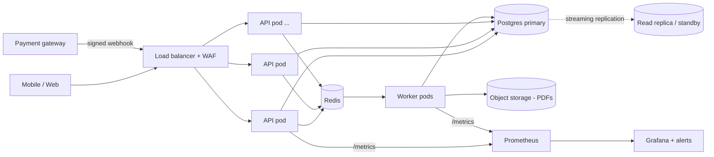

# Architecture

Backend for Amrutam's telemedicine flow: patients find an Ayurveda doctor, book a slot,
pay, attend the consultation and get a prescription. This doc covers how it's put
together and why, and where it would need to change as load grows.

## 1. Targets and what they mean in numbers

| Requirement | Working number |
|---|---|
| 100k consultations/day | ~1.2 bookings/s on average, assume ~15/s at the morning peak |
| Read traffic | search + slot listing ~30-50x bookings -> plan for ~600 rps peak |
| p95 < 200ms reads, < 500ms writes | measured locally: reads ~22ms, bookings ~140ms p95 (see README) |
| 99.95% availability | ~22 min downtime/month: no single AZ, no single instance, no long migrations |
| Data growth | ~3M consultations/month, audit log ~15-20 rows per consultation (~50M/month) |

At this scale one well-sized Postgres primary is enough for writes. The things that
actually hurt are read fan-out on search, hot-slot contention at peak, and tables that
grow forever (audit, consultations). Most of the design below is about those three.

## 2. High level



- **API** (`src/server.js`) is stateless Express. It scales horizontally behind the LB
  (HPA on CPU, min 3 pods spread across zones).
- **Worker** (`src/worker.js`) is the same image with a different command. It runs
  BullMQ jobs: hold expiry, refunds, PDF rendering, notifications, analytics refresh
  and partition upkeep. Slow work never sits on the request path.
- **Postgres** is the source of truth for everything, including booking correctness.
- **Redis** has four jobs: cache, rate-limit counters, idempotency records, and the
  job queue. A short slot lock lives there too. Losing Redis degrades the system: it
  gets slower and writes return 503 instead of risking duplicates. It never corrupts data.

Code layout is module per domain (`auth`, `doctors`, `availability`, `bookings`,
`payments`, `consultations`, `prescriptions`, `admin`, `audit`), each split into
`routes -> service -> repo`. Dependencies are wired by hand in `src/container.js`
(constructor injection via factory functions). The tests use that same seam.

## 3. Booking flow

```mermaid
sequenceDiagram
  autonumber
  participant P as Patient app
  participant A as API
  participant R as Redis
  participant DB as Postgres
  participant Q as Queue/Worker
  participant G as Payment gateway

  P->>A: POST /bookings {slotId} + Idempotency-Key
  A->>R: SET idem:{user}:{key} NX (processing)
  A->>R: SET lock:slot:{id} NX PX 5000
  A->>DB: BEGIN; SELECT slot FOR UPDATE
  A->>DB: slot -> held (until now+10m), INSERT consultation(pending), INSERT payment(created)
  A->>DB: COMMIT
  A->>R: release slot lock (compare-and-delete)
  A->>Q: delayed job booking.expire (+10m)
  A->>R: store response under idempotency key
  A-->>P: 201 {consultation, payment, holdExpiresAt}

  P->>G: pay
  G->>A: POST /payments/webhook (HMAC signed)
  A->>DB: BEGIN; lock consultation, payment
  alt payment succeeded and still pending
    A->>DB: payment succeeded, consultation confirmed, slot booked
    A->>Q: notify
  else payment failed
    A->>DB: payment failed, consultation cancelled, slot open
  else succeeded but hold already expired
    A->>DB: payment succeeded (consultation stays cancelled)
    A->>Q: payment.refund
  end
  A-->>G: 200 (duplicate deliveries -> no-op)

  Note over Q,DB: 10 min later booking.expire runs: no-op unless still pending,<br/>otherwise cancel + reopen slot. A 1-min sweeper catches lost jobs.
```

## 4. Data model

```mermaid
erDiagram
  users ||--|| profiles : has
  users ||--o| doctors : "is (role=doctor)"
  users ||--o{ refresh_tokens : has
  doctors ||--o{ availability_slots : publishes
  availability_slots ||--o{ consultations : "booked as"
  users ||--o{ consultations : "patient of"
  doctors ||--o{ consultations : "doctor of"
  consultations ||--o| prescriptions : produces
  consultations ||--o{ payments : "paid by"
  users ||--o{ audit_logs : "actor in"

  users {
    uuid id PK
    text email UK
    text role
    text status
    bool mfa_enabled
    text mfa_secret_enc
  }
  profiles {
    uuid user_id PK
    text full_name
    text phone_enc
    date date_of_birth
    text city
  }
  doctors {
    uuid user_id PK
    text registration_no UK
    text specialization
    text_array languages
    int fee_paise
    numeric rating_avg
    bool is_verified
  }
  availability_slots {
    uuid id PK
    uuid doctor_id FK
    timestamptz starts_at
    timestamptz ends_at
    text status
    timestamptz held_until
  }
  consultations {
    uuid id PK
    timestamptz scheduled_at PK
    uuid slot_id FK
    text status
    text reason_enc
    text doctor_notes_enc
  }
  prescriptions {
    uuid id PK
    uuid consultation_id FK
    text medications_enc
    text pdf_path
  }
  payments {
    uuid id PK
    uuid consultation_id FK
    int amount_paise
    text status
    text provider_ref UK
  }
  audit_logs {
    uuid id PK
    timestamptz created_at PK
    uuid actor_id
    text action
    text resource_type
    text resource_id
    jsonb metadata
  }
```



Some choices that aren't obvious from the diagram:

- Money is stored as integer paise. No floats anywhere near payments.
- `availability_slots` has an `EXCLUDE USING gist` constraint, so one doctor can never
  have overlapping slots, whatever the app code does.
- `consultations` has a partial unique index on `(slot_id, scheduled_at) WHERE status
  IN (pending, confirmed, in_progress)`. That is the real double-booking guarantee.
  The Redis lock only makes losers fail fast.
- `*_enc` columns are AES-256-GCM ciphertext (see security.md). The DB never sees PHI
  in clear text, and neither do backups.
- `audit_logs` rejects UPDATE/DELETE with a trigger.

## 5. Retries and backoff

| Where | Strategy |
|---|---|
| Background jobs | BullMQ, 5 attempts, exponential backoff from 2s (2, 4, 8, 16s). Every handler is idempotent (state checks / jobIds), so a retry or a double run can't double-refund or double-cancel. Permanently failed jobs are kept for 7 days and logged at error level. |
| Redis client | reconnect with `min(2^n * 50ms, 2s)`, max 2 retries per command so a request fails fast instead of hanging |
| Lost jobs | `maintenance.sweep-holds` runs every minute and expires holds whose job never fired (Redis flush, crash between commit and enqueue) |
| Clients | 409 `SLOT_BUSY` / `REQUEST_IN_PROGRESS` and 503 are retryable with the same Idempotency-Key. 429 sends `Retry-After`. Clients should back off with jitter. |
| Payment gateway | webhooks are expected to be redelivered. We return 200 for duplicates so the gateway stops retrying. |
| Postgres | `statement_timeout` 5s and connect timeout 5s, so slow queries surface as errors and don't pile up connections |

What I'd add next: jitter on job backoff (BullMQ supports a custom backoff function),
and a circuit breaker around the real gateway client once there is one.

## 6. Partitioning

`consultations` and `audit_logs` are range-partitioned by month (`scheduled_at`,
`created_at`). The migration creates previous month + next 12, and a daily job keeps
3 months ahead (`create_monthly_partition()`).

Why month and why these two tables:
- Patient and doctor history queries always have a time bound, so the planner prunes
  down to one or two partitions.
- Retention becomes `DETACH PARTITION` + archive to cold storage, with no huge DELETEs
  and no vacuum storms. Audit logs (the biggest table) can move to cheap storage after
  the compliance window without touching hot data.
- Indexes stay small per partition.

Trade-off: a lookup by `id` alone checks every partition's PK index (~14 probes).
That's fine at this size. If it ever matters, the consultation id could encode its
month, or clients could send `scheduled_at`.

**Beyond one primary:** the natural shard key is `doctor_id`. Slots, consultations and
most writes are per doctor, and a patient's history is a cross-shard read that tolerates
being slower. Citus or app-level routing would work. I don't think 100k/day needs it yet.

## 7. Caching and concurrency

**Cache** (Redis, read-through, `src/lib/cache.js`):

| Data | TTL | Invalidation |
|---|---|---|
| Doctor search pages | 60s | version counter `ver:doctors` bumped on profile/verification change |
| Doctor profile | 5 min | key deleted on change |
| Open slots per doctor/date range | 30s | `ver:slots:{doctorId}` bumped on every hold/book/release/create |

Version counters avoid `SCAN`+`DEL`. A bump just makes old keys unreachable, and they
age out on their own. Cache errors fall back to the DB, so the cache is never on the
correctness path. Booking always re-reads the slot under a row lock, so a stale
listing can only cause a clean 409, never a bad booking.

**Concurrency on a hot slot** has three layers:
1. Redis `SET NX PX` slot lock. Losers get `409 SLOT_BUSY` without touching Postgres.
2. `SELECT ... FOR UPDATE` on the slot row inside the booking transaction.
3. Partial unique index on active consultations per slot. Even a buggy code path can't
   create two.

The integration test fires 8 parallel bookings at one slot and expects exactly one 201.
The e2e run did 15 and got the same result.

Deadlocks: every multi-row transaction locks in the same order,
consultation -> payment -> slot.

## 8. Transactions and the booking saga

Booking spans the DB, the queue and an external gateway, so it can't be one ACID
transaction. It's an orchestrated saga in `bookings.service.js`, where each step is a
local Postgres transaction:

| Step | Action | Compensation |
|---|---|---|
| 1. reserve | slot held, consultation pending, payment created | expire: consultation cancelled, slot open, payment failed |
| 2a. pay ok | payment succeeded, consultation confirmed, slot booked | patient/doctor cancel -> refund job (policy based) |
| 2b. pay failed | payment failed | consultation cancelled, slot open |
| late success | payment succeeded after step-1 compensation | refund job |

Rules that keep it safe:
- **Idempotent steps.** Each step checks current state under a row lock and does
  nothing if it already happened. Webhook replays, job retries and the sweeper can
  all run the same step twice.
- **Commit, then enqueue.** If the enqueue fails after commit, the sweeper picks the
  booking up. We never enqueue inside the transaction, because a job could run before
  the commit is visible.
- **State machine** (`stateMachine.js`) rejects illegal transitions (e.g. completed ->
  cancelled) with 409, so a late or duplicated event can't move things backwards.

An outbox table would replace "commit then enqueue + sweeper" if we added more
consumers (analytics stream, notifications service). For now the sweeper is simpler
and covers the one case that matters.

## 9. Backup and DR

| | Plan |
|---|---|
| Postgres HA | managed Postgres (RDS / Cloud SQL) Multi-AZ, synchronous standby, automatic failover (~1-2 min) |
| Backups | daily snapshots + continuous WAL archiving -> point-in-time recovery, 35 day retention, copied to a second region |
| RPO / RTO | RPO <= 5 min (cross-region WAL shipping), same-region failover RTO ~2 min, full region loss RTO ~1h (promote cross-region replica, repoint DNS) |
| Redis | replica + automatic failover (ElastiCache / Sentinel), AOF on. Data loss here is tolerable by design: the cache rebuilds, idempotency keys are a 24h convenience on top of DB constraints, and lost jobs are swept |
| PDFs / object storage | versioned bucket with cross-region replication |
| Encryption keys | KMS, multi-region keys. Backups are useless without them, so key backup gets the same care as the DB |
| Drills | quarterly restore of the latest backup into a scratch environment, timed, with the checklist in the runbook. A backup you haven't restored isn't a backup |

Application-level: migrations are forward-only and additive (expand -> migrate ->
contract), so a rollback is just deploying the previous image.

## 10. Observability

- **Logs:** pino JSON, one line per request (route template, status, latency, user id),
  with `reqId` and `traceId` on every line, job logs included. The trace id travels
  inside the job payload. Secrets and tokens are redacted at the logger.
- **Metrics:** `/metrics` on the API and `:9464/metrics` on the worker. Latency
  histograms with buckets at the SLO thresholds, business counters (bookings by
  outcome, payments, jobs), DB pool and query latency.
  `docker compose --profile observability up` brings up Prometheus + a Grafana
  dashboard, and `infra/prometheus/alerts.yml` has the SLO alerts.
- **Traces:** W3C `traceparent` is accepted and returned, and the trace id is carried
  through logs and jobs. The next step is the OpenTelemetry SDK with an OTLP exporter.
  The ids are already in the right format, so spans would line up with existing logs.

## 11. Known gaps / next steps

- Real payment gateway client (Razorpay), with its own idempotency keys and a circuit breaker.
- PDFs on S3 with pre-signed download URLs. Today they're on local disk, which only
  works when API and worker share a volume.
- Outbox table if more async consumers appear.
- OpenTelemetry spans, as above.
- Doctor ratings and reviews (the columns exist, no write path yet).
